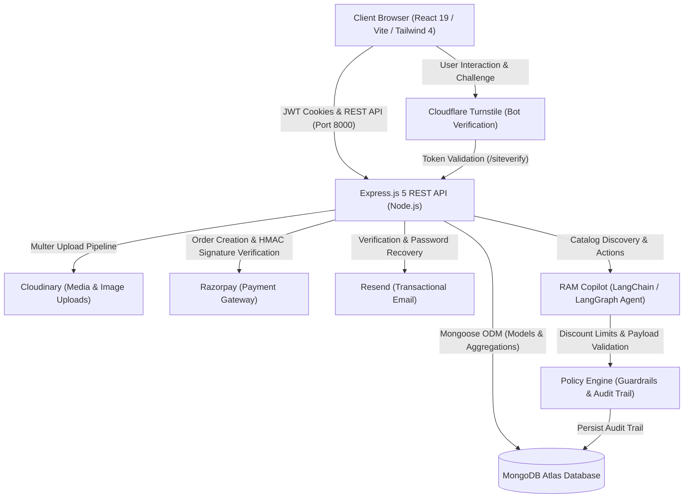

# 🛒 Buy-It — Full-Stack E-Commerce Monorepo

[](LICENSE)
[](https://github.com/basantbansal/Ecommerce_website_monorepo/actions/workflows/ci.yml)
[](https://react.dev/)
[](https://vitejs.dev/)
[](https://nodejs.org/)
[](https://expressjs.com/)
[](https://www.mongodb.com/)
[](https://tailwindcss.com/)
[](https://www.cloudflare.com/products/turnstile/)

A full-stack e-commerce web platform and monorepo featuring customer and seller role-based access control, cryptographic session authentication, Cloudflare Turnstile bot deterrence, Cloudinary media processing, Razorpay payment processing, and an autonomous AI commerce copilot (**RAM Copilot**) with deterministic policy engine guardrails built on LangChain and LangGraph.

* 🌐 **Live Storefront (Vercel):** [https://e-commerce-website-ten-dusky.vercel.app](https://e-commerce-website-ten-dusky.vercel.app)
* ⚡ **Live API Service (Render):** [https://my-backend-6vy3.onrender.com/api/v1/health](https://my-backend-6vy3.onrender.com/api/v1/health)

<p align="center">
  
</p>

---

## 📋 Table of Contents

- [Project Origins & Canonical Monorepo](#-project-origins--canonical-monorepo)
- [System Architecture](#️-system-architecture)
- [Feature Overview & Service Limitations](#-feature-overview--service-limitations)
- [Technology Stack](#️-technology-stack)
- [Repository Layout](#-repository-layout)
- [Prerequisites](#-prerequisites)
- [Local Development Setup](#-local-development-setup)
- [Available Scripts & Commands](#-available-scripts--commands)
- [Environment Variables Reference](#-environment-variables-reference)
- [Third-Party Services Configuration](#-third-party-services-configuration)
- [Deployment Guide (Vercel & Render)](#-deployment-guide-vercel--render)
- [Backend REST API Overview](#-backend-rest-api-overview)
- [Testing & Quality Verification](#-testing--quality-verification)
- [Security Architecture](#-security-architecture)
- [Troubleshooting](#-troubleshooting)
- [Contributing](#-contributing)
- [License](#-license)

---

## 📌 Project Origins & Canonical Monorepo

This repository represents the **canonical, consolidated monorepo** uniting two previously separated repositories into a single unified development and deployment workspace:

* **Original Frontend Repository:** [basantbansal/Ecommerce_website_frontend](https://github.com/basantbansal/Ecommerce_website_frontend)
* **Original Backend Repository:** [basantbansal/Ecommerce_website_backend](https://github.com/basantbansal/Ecommerce_website_backend)

> [!NOTE]
> **Provenance & Continuity:**
> All historical features, API contracts, schema structures, and UI components from both repositories are preserved here. Going forward, all active development, issues, pull requests, and production deployments are driven exclusively from this canonical monorepo.

---

## 🏗️ System Architecture



---

## ✨ Feature Overview & Service Limitations

### 1. Implemented Features

* **Authentication & Role Authorization:**
  * Double-cookie token pattern: short-lived access tokens and long-lived refresh tokens stored as secure `httpOnly`, `sameSite` cookies.
  * Password encryption via `bcrypt` with salt rounds.
  * Role-based access control distinguishing `customer`, `seller`, and `admin` roles.
  * Google OAuth 2.0 Sign-In via `@react-oauth/google` with server-side token validation through `google-auth-library`.
  * Bot protection on authentication endpoints powered by Cloudflare Turnstile.
* **Storefront & Catalog Management:**
  * Responsive product showcase with category filtering, real-time search, live stock availability indicators, and currency formatting (`Rs.`).
  * Product detail views featuring image galleries, specifications, stock thresholds, and instant cart additions.
  * Seller portal allowing authorized users to upload product media via Multer/Cloudinary, update inventory stock, and manage active listings.
* **Cart, Checkout & Payments:**
  * Persistent cart synchronization across user sessions backed by MongoDB.
  * Idempotent order placement: unique `Idempotency-Key` headers prevent accidental duplicate orders and double billing.
  * Complete Razorpay integration: server-side order creation, client checkout modal, and cryptographic `HMAC-SHA256` payment signature verification.
  * Itemized order history dashboard tracking purchase timestamps, delivery statuses, and payment IDs.
* **RAM Copilot (AI Commerce Assistant):**
  * Embedded shopping assistant powered by LangChain and LangGraph for natural-language product discovery.
  * Deterministic Policy Engine enforcing hard boundaries: maximum 15% discount cap, strict transaction limits (capped at ₹50,000), and automated blocking of prompt injection attacks.
  * Comprehensive database audit trail (`AgentAuditTrail`) recording each action, prompt, and policy decision.

### 2. Verified Service Limitations & Constraints

* **Resend Free Tier Sandbox Restriction:**
  When using Resend's default onboarding domain (`onboarding@resend.dev`), Resend **only permits delivery to the single email address registered to the Resend account owner**. To deliver password-reset or verification emails to arbitrary customer addresses in production, a custom sending domain must be registered and verified in the Resend dashboard.
* **Cloudflare Turnstile Key Pairing:**
  Cloudflare's `/siteverify` endpoint strictly enforces that the secret key on the backend matches the public sitekey on the frontend. Local development uses Cloudflare's official "Always Passes" dummy test key pair (`1x000...AA`). In production, both Vercel and Render must be configured with a matched production key pair whose domain includes the live Vercel domain.
* **Local AI Copilot Runtime:**
  The AI Copilot connects by default to a local LLM runner (OmniRoute on `http://localhost:20128/v1`). When running in cloud hosting without a local model server, the assistant falls back safely or connects to remote OpenAI / Anthropic endpoints when configured.

---

## 🛠️ Technology Stack

| Domain | Technologies |
| :--- | :--- |
| **Frontend Framework** | [React 19](https://react.dev/), [Vite 6](https://vitejs.dev/) |
| **Styling & UI** | [Tailwind CSS 4](https://tailwindcss.com/), [React Icons](https://react-icons.github.io/react-icons/), [GSAP](https://greensock.com/gsap/) |
| **Client Routing & State** | [React Router DOM 7](https://reactrouter.com/), React Context API |
| **Backend Runtime & API** | [Node.js](https://nodejs.org/) (ES Modules), [Express 5](https://expressjs.com/) |
| **Database & ODM** | [MongoDB Atlas](https://www.mongodb.com/), [Mongoose 9](https://mongoosejs.com/) (`mongoose-aggregate-paginate-v2`) |
| **Security & Authentication** | JSON Web Tokens (`jsonwebtoken`), `bcrypt`, Cloudflare Turnstile, `@react-oauth/google` |
| **Payment Gateway** | [Razorpay](https://razorpay.com/) Node.js SDK & Checkout JS |
| **Media & File Storage** | [Cloudinary](https://cloudinary.com/) API via [Multer](https://github.com/expressjs/multer) (UUID filename protection) |
| **Transactional Email** | [Resend](https://resend.com/) SDK |
| **AI Agent & Guardrails** | [LangChain Core](https://js.langchain.com/), [LangGraph](https://langchain-ai.github.io/langgraphjs/), Custom Policy Engine |
| **Testing & CI Tooling** | Node.js Test Runner (`node:test`, `node:assert`), GitHub Actions, [ESLint 9](https://eslint.org/), [Prettier](https://prettier.io/) |

---

## 📂 Repository Layout

```
Ecommerce_website_monorepo/
├── .github/
│   ├── ISSUE_TEMPLATE/        # Standardized GitHub issue templates
│   └── workflows/
│       └── ci.yml             # GitHub Actions CI workflow (tests, syntax, lint, build)
├── backend/
│   ├── public/temp/           # Temporary staging directory for Multer file uploads
│   ├── src/
│   │   ├── controllers/       # Business logic (user, product, cart, order, payment, agent)
│   │   ├── db/                # MongoDB Mongoose connection handler
│   │   ├── middlewares/       # JWT verification and Multer upload middlewares
│   │   ├── models/            # Mongoose schemas (User, Product, Cart, Order, Payment, Audit)
│   │   ├── routes/            # Express REST route declarations
│   │   ├── scripts/           # Catalog seeders, adversarial tests, and verification scripts
│   │   ├── services/          # RAM Copilot agent core, tool registry & policy engine
│   │   ├── tests/             # Automated test suite (forgot password, email delivery, proxy)
│   │   ├── utils/             # ApiError, ApiResponse, asyncHandler, Cloudinary & Resend helpers
│   │   ├── app.js             # Express application configuration & proxy setup
│   │   ├── index.js           # Server bootstrap entry point
│   │   └── setup.js           # Dotenv environment configuration loader
│   ├── .env.example           # Backend environment template
│   ├── .env.sample            # Backward-compatible sample template
│   ├── nodemon.json           # Nodemon watcher configuration
│   └── package.json           # Backend dependencies and test scripts
├── frontend/
│   ├── public/                # Static assets, icons, and avatars
│   ├── src/
│   │   ├── assets/            # Vector logos and graphics
│   │   ├── components/        # Reusable UI components & RAM Copilot chat interface
│   │   ├── context/           # React Context providers (User, Cart, Purchased)
│   │   ├── pages/             # Application route views (Home, Details, Cart, Auth, Seller)
│   │   ├── api.js             # Centralized Axios client with automatic base URL detection
│   │   ├── App.js             # Client routing and shell layout
│   │   └── index.js           # React root rendering and OAuth provider wrapper
│   ├── .env.example           # Frontend environment template
│   ├── .env.sample            # Backward-compatible sample template
│   ├── eslint.config.js       # ESLint 9 configuration
│   ├── vercel.json            # Vercel SPA routing rewrites configuration
│   ├── vite.config.js         # Vite bundler configuration (port 3000, React, Tailwind)
│   └── package.json           # Frontend dependencies and scripts
├── .env.example               # Root reference environment template
├── .gitignore                 # Comprehensive gitignore protecting credentials and builds
├── CONTRIBUTING.md            # Guidelines for open-source contributors
├── LICENSE                    # MIT License
└── README.md                  # Canonical project documentation
```

---

## 📦 Prerequisites

* **Node.js**: v18.0.0 or higher (v20+ recommended)
* **npm**: v9.0.0 or higher
* **MongoDB**: A running local MongoDB instance (`mongodb://localhost:27017`) or a free [MongoDB Atlas](https://www.mongodb.com/atlas) cluster connection string

---

## 🚀 Local Development Setup

Follow these steps from a fresh clone to get both services running locally. **No paid third-party accounts are required** for basic browsing, cart management, and local authentication.

### Step 1: Clone the Repository

```bash
git clone https://github.com/basantbansal/Ecommerce_website_monorepo.git
cd Ecommerce_website_monorepo
```

### Step 2: Install Dependencies

```bash
# Install backend dependencies
npm --prefix backend install

# Install frontend dependencies
npm --prefix frontend install
```

### Step 3: Configure Environment Files

#### 1. Backend Environment
Copy `backend/.env.example` to `backend/.env`:

```bash
cp backend/.env.example backend/.env
```

Ensure the minimal local variables are set in `backend/.env`:
* `PORT=8000`
* `NODE_ENV=development`
* `MONGODB_URI=mongodb://localhost:27017`
* `ACCESS_TOKEN_SECRET=your_local_access_secret_minimum_32_characters`
* `REFRESH_TOKEN_SECRET=your_local_refresh_secret_minimum_32_characters`
* `TURNSTILE_SECRET_KEY=1x0000000000000000000000000000000AA` *(Cloudflare public test key)*
* `FRONTEND_URL=http://localhost:3000`

#### 2. Frontend Environment
Copy `frontend/.env.example` to `frontend/.env.local`:

```bash
cp frontend/.env.example frontend/.env.local
```

Ensure the minimal local variables are set in `frontend/.env.local`:
* `VITE_API_URL=http://localhost:8000`
* `VITE_TURNSTILE_SITE_KEY=1x00000000000000000000AA` *(Cloudflare public test key)*

### Step 4: Seed the Product Catalog (Optional)

```bash
# Seed standard initial catalog
node backend/src/scripts/seedProducts.cjs

# Or seed expanded catalog with multiple categories
node backend/src/scripts/seedExpandedProducts.cjs
```

### Step 5: Start Development Servers

Run the backend API and frontend client in separate terminal windows:

```bash
# Terminal 1 — Start Backend API (http://localhost:8000)
npm --prefix backend run dev

# Terminal 2 — Start Frontend Client (http://localhost:3000)
npm --prefix frontend start
```

Open **`http://localhost:3000`** in your browser.

---

## 💻 Available Scripts & Commands

All commands can be executed directly from the monorepo root:

| Scope | Command | Purpose |
| :--- | :--- | :--- |
| **Backend** | `npm --prefix backend run dev` | Starts backend with Nodemon live reload (watches `src/` and `.env`) |
| **Backend** | `npm --prefix backend start` | Starts backend in standard production mode (`node src/index.js`) |
| **Backend** | `npm --prefix backend test` | Runs automated test suite (`node --test src/tests/**/*.test.js`) |
| **Backend** | `node backend/src/scripts/test_adversarial.js` | Runs adversarial policy engine guardrail test suite |
| **Backend** | `node backend/src/scripts/runTests.js` | Runs AI Copilot scenario integration tests |
| **Frontend** | `npm --prefix frontend start` | Starts Vite development server on `http://localhost:3000` |
| **Frontend** | `npm --prefix frontend run build` | Compiles optimized production bundle into `frontend/dist` |
| **Frontend** | `npm --prefix frontend run lint` | Runs ESLint 9 checks across all frontend source files |
| **Frontend** | `npm --prefix frontend run preview` | Locally serves production build for smoke testing |

---

## 🔐 Environment Variables Reference

Below is the complete reference of all environment variables used by the platform. **Never commit real secrets or credentials to Git.**

| Variable | Package | Required | Description & Safe Placeholder |
| :--- | :--- | :---: | :--- |
| `PORT` | Backend | No | Port for Express server (defaults to `8000` or `process.env.PORT` on Render) |
| `NODE_ENV` | Backend | No | Execution environment (`development` or `production`) |
| `MONGODB_URI` | Backend | **Yes** | MongoDB connection string (`mongodb://localhost:27017` or Atlas URI) |
| `ACCESS_TOKEN_SECRET` | Backend | **Yes** | Cryptographic secret for signing access JWTs (min 32 chars) |
| `REFRESH_TOKEN_SECRET`| Backend | **Yes** | Cryptographic secret for signing refresh JWTs (min 32 chars) |
| `ACCESS_TOKEN_EXPIRY` | Backend | No | Access token expiration duration (defaults to `1d`) |
| `REFRESH_TOKEN_EXPIRY`| Backend | No | Refresh token expiration duration (defaults to `7d`) |
| `FRONTEND_URL` | Backend | **Yes** | URL of frontend client for CORS and email links (`http://localhost:3000`) |
| `CORS_ORIGIN` | Backend | No | Comma-delimited list of extra allowed CORS origins |
| `TURNSTILE_SECRET_KEY`| Backend | **Yes** | Cloudflare Turnstile secret (`1x000...AA` for local testing) |
| `RESEND_API_KEY` | Backend | No | Resend API key (`re_...`) for verification and password reset emails |
| `EMAIL_FROM` | Backend | No | Sender address (`Amazing Store <onboarding@resend.dev>` or verified domain) |
| `CLOUDINARY_CLOUD_NAME`| Backend| No | Cloudinary cloud name for seller image uploads |
| `CLOUDINARY_API_KEY` | Backend | No | Cloudinary API key |
| `CLOUDINARY_API_SECRET`| Backend | No | Cloudinary API secret |
| `RAZORPAY_KEY_ID` | Backend | No | Razorpay key ID (`rzp_test_...` for test mode) |
| `RAZORPAY_KEY_SECRET` | Backend | No | Razorpay key secret |
| `GOOGLE_CLIENT_ID` | Backend | No | Google OAuth 2.0 Web Client ID for server-side token validation |
| `ANTHROPIC_AUTH_TOKEN`| Backend | No | Local OmniRoute or Anthropic API token for AI Copilot |
| `GOOGLE_API_KEY` | Backend | No | Google Gemini API key for AI Copilot fallback |
| `VITE_API_URL` | Frontend | No | Base URL of backend API (defaults to `http://localhost:8000` locally) |
| `VITE_TURNSTILE_SITE_KEY`| Frontend| **Yes** | Cloudflare Turnstile site key (`1x000...AA` for local testing) |
| `VITE_GOOGLE_CLIENT_ID`| Frontend| No | Google OAuth Web Client ID for frontend button render |
| `VITE_RAZORPAY_KEY_ID` | Frontend | No | Razorpay public key ID (`rzp_test_...`) for client checkout modal |

---

## 🔌 Third-Party Services Configuration

### 1. Cloudflare Turnstile (Bot Deterrence)
* **Local Development:** Pre-configured with Cloudflare's public test keys. The CAPTCHA passes automatically without user interaction.
* **Production:** Create a widget in the [Cloudflare Turnstile Dashboard](https://dash.cloudflare.com/?to=/:account/turnstile). Add your Vercel domain (`e-commerce-website-ten-dusky.vercel.app`) to the Allowed Domains list. Set the resulting sitekey in Vercel and secret key in Render.

### 2. Resend (Transactional Email)
* Create an API key in the [Resend API Keys Dashboard](https://resend.com/api-keys).
* Add `RESEND_API_KEY` to Render environment variables.
* **Free Tier Notice:** If using `onboarding@resend.dev`, emails will only be delivered to your Resend account email address. For public customer registration and recovery, verify a custom domain under [Resend Domains](https://resend.com/domains) and set `EMAIL_FROM="Support <support@yourdomain.com>"`.

### 3. Razorpay (Payment Processing)
* Generate test keys in the [Razorpay Dashboard](https://dashboard.razorpay.com/#/app/keys) (Settings &rarr; API Keys &rarr; Generate Test Key).
* Add `RAZORPAY_KEY_ID` and `RAZORPAY_KEY_SECRET` to Render, and `VITE_RAZORPAY_KEY_ID` to Vercel.
* In test mode, use Razorpay test card credentials (any future expiry date, CVV `123`, OTP `123456`) to complete mock payments safely without real charges.

### 4. Cloudinary (Seller Media Uploads)
* Retrieve your Cloud Name, API Key, and API Secret from the [Cloudinary Console](https://console.cloudinary.com/).
* Add these credentials to backend environment variables. Image uploads use secure UUID filenames to prevent path traversal attacks.

---

## 🌐 Deployment Guide (Vercel & Render)

### Backend Deployment on Render

1. Log in to [Render](https://dashboard.render.com/) and navigate to your `my_backend` Web Service (or create a new Web Service pointing to `Ecommerce_website_monorepo`).
2. In **Settings**, configure the monorepo root directory and commands:
   * **Root Directory:** `backend` *(Essential: Render must run inside the backend folder)*
   * **Environment:** `Node`
   * **Build Command:** `npm install` (or `npm ci`)
   * **Start Command:** `npm start`
   * **Health Check Path:** `/api/v1/health`
3. In **Environment**, configure the production environment variables outlined in the [Reference Table](#-environment-variables-reference). Ensure `NODE_ENV=production` and `FRONTEND_URL=https://e-commerce-website-ten-dusky.vercel.app`.

### Frontend Deployment on Vercel

1. Log in to [Vercel](https://vercel.com/) and navigate to your frontend project.
2. In **Settings &rarr; General**:
   * **Root Directory:** Set to `frontend` *(Essential: Vercel must build inside the frontend folder)*
   * **Framework Preset:** `Vite`
   * **Build Command:** `npm run build`
   * **Output Directory:** `dist`
3. In **Settings &rarr; Environment Variables**, configure:
   * `VITE_API_URL`: `https://my-backend-6vy3.onrender.com`
   * `VITE_TURNSTILE_SITE_KEY`: Production Turnstile sitekey from Cloudflare.
   * `VITE_GOOGLE_CLIENT_ID` and `VITE_RAZORPAY_KEY_ID`: Production or test IDs as required.
4. SPA Routing: Handled automatically by [`frontend/vercel.json`](frontend/vercel.json) rewrite rule (`/(.*) -> /index.html`).

---

## 📡 Backend REST API Overview

All API routes are served under `/api/v1` and protected by rate limiting (`express-rate-limit`):

```
/api/v1
├── /health
│   └── GET  /                      # Service status & MongoDB health probe
├── /users
│   ├── POST /register              # Account registration (Multer image upload)
│   ├── POST /login                 # Turnstile-validated credential authentication
│   ├── POST /google-login          # Google OAuth ID token authentication
│   ├── POST /verify-email          # Email verification with SHA-256 token
│   ├── POST /resend-verification   # Resend email verification link
│   ├── POST /forgot-password       # Enumeration-safe password reset initiation
│   ├── POST /reset-password        # Password reset completion with token
│   ├── POST /logout                # Invalidate session and clear cookies
│   ├── POST /refresh-token         # Rotate JWT access token using refresh cookie
│   ├── GET  /current-user          # Authenticated user profile (verifyJWT)
│   ├── POST /become-seller         # Elevate user role to seller (verifyJWT)
│   ├── POST /change-password       # Update account password (verifyJWT)
│   └── PATCH /update-account       # Update full name profile field (verifyJWT)
├── /products
│   ├── GET  /                      # Paginated product list with search & category filter
│   ├── GET  /agent-catalog         # Lightweight catalog for AI agent reasoning
│   ├── GET  /:productId            # Full product details by ID
│   ├── POST /store-products        # Create product with Cloudinary image (Seller)
│   ├── PATCH /:productId/stock     # Update inventory stock quantity (Seller)
│   └── DELETE /:productId          # Delete product listing (Seller)
├── /cart
│   ├── GET  /                      # Retrieve user's active cart items (verifyJWT)
│   ├── POST /items                 # Add product to cart (verifyJWT)
│   ├── PATCH /items/:productId     # Update item quantity in cart (verifyJWT)
│   ├── DELETE /items/:productId    # Remove specific item from cart (verifyJWT)
│   └── DELETE /                    # Clear all items from cart (verifyJWT)
├── /orders
│   ├── GET  /                      # Fetch customer purchase history (verifyJWT)
│   └── POST /                      # Create new order with Idempotency-Key (verifyJWT)
├── /payments
│   ├── POST /:paymentId/confirm         # Confirm manual / COD payment (verifyJWT)
│   ├── POST /:paymentId/razorpay-order  # Generate Razorpay gateway order (verifyJWT)
│   └── POST /:paymentId/razorpay-verify # Verify HMAC-SHA256 signature (verifyJWT)
└── /agent
    ├── POST /chat                  # Chat with RAM Copilot AI assistant (verifyJWT)
    └── GET  /audit/:sessionId      # Inspect policy decisions & audit trail (verifyJWT)
```

---

## 🛡️ Testing & Quality Verification

The repository includes a comprehensive automated test suite and strict verification procedures:

### 1. Backend Automated Tests (`node:test`)
Run the automated test suite covering password reset flows, provider error handling, proxy configuration, and enumeration protection:

```bash
npm --prefix backend test
```

**Test Coverage Highlights:**
* ✅ **Successful Sending:** Verifies reset token generation, secure hashing, Resend dispatch, and generic HTTP 200 response.
* ✅ **Provider Rejection:** Validates that third-party delivery failures safely throw HTTP 503 instead of false HTTP 200.
* ✅ **Missing Configuration:** Verifies HTTP 500 when `RESEND_API_KEY` is undefined.
* ✅ **Account Enumeration Protection:** Guarantees non-existent accounts receive the exact same generic 200 response without triggering outbound API calls.
* ✅ **Unexpected Errors:** Validates safe HTTP 503 handling for database write failures.
* ✅ **Email Utility Unit Tests:** Validates argument parsing and error propagation in `sendEmail`.
* ✅ **Proxy Configuration:** Asserts `app.get("trust proxy") === 1` for Render compatibility.

### 2. AI Policy Engine & Security Guardrails
Run adversarial testing against the RAM Copilot commerce engine:

```bash
# Adversarial boundary and race condition suite
node backend/src/scripts/test_adversarial.js

# Copilot shopping integration scenarios
node backend/src/scripts/runTests.js
```

### 3. Frontend Code Quality
Validate linting rules and production compilation:

```bash
# Run ESLint 9 checks
npm --prefix frontend run lint

# Compile Vite production bundle
npm --prefix frontend run build
```

---

## 🔒 Security Architecture

1. **Reverse Proxy & Rate Limiting (`trust proxy 1`):**
   Configured with `app.set("trust proxy", 1)` to trust only the front-facing Render proxy hop. This enables `express-rate-limit` to accurately extract client IPs from `X-Forwarded-For` without blindly trusting spoofed upstream headers.
2. **Account Enumeration Defense:**
   Password recovery and email verification endpoints return consistent generic responses regardless of whether the email exists in the database.
3. **Sensitive Credential Protection:**
   Raw password-reset tokens and verification URLs are never output to production server logs.
4. **Path Traversal Defense:**
   Multer disk storage generates cryptographically random UUID filenames (`crypto.randomUUID()`) for all uploaded media assets.
5. **Server-Side Price Validation:**
   Order amounts are calculated exclusively server-side from product documents stored in MongoDB, ensuring client payloads cannot manipulate item prices.
6. **Payment HMAC Integrity:**
   Razorpay payment confirmations require an exact cryptographic match between `razorpay_signature` and the computed `HMAC-SHA256` of `order_id|payment_id` using the server's private secret.

---

## 🔧 Troubleshooting

* **Forgot password returns success but no email arrives:**
  Check whether you are using Resend's free tier (`onboarding@resend.dev`). Resend blocks delivery to any recipient other than the registered account owner. To send to any customer address, verify a custom domain under [Resend Domains](https://resend.com/domains).
* **Login fails with "Security check failed":**
  Ensure `TURNSTILE_SECRET_KEY` on Render and `VITE_TURNSTILE_SITE_KEY` on Vercel are properly paired. In local development, verify both files use the Cloudflare test key pair (`1x000...AA`).
* **Vercel builds fail with "Cannot find package.json":**
  In Vercel Project Settings &rarr; General, verify that the **Root Directory** is explicitly set to `frontend`.
* **Render builds fail or cannot locate entry point:**
  In Render Service Settings, ensure the **Root Directory** is explicitly set to `backend` and Start Command is `npm start`.

---

## 🤝 Contributing

Contributions are welcome! Please follow these guidelines:

1. Fork the repository.
2. Create a feature branch: `git checkout -b feature/your-feature-name`.
3. Ensure all tests and lint checks pass: `npm --prefix backend test && npm --prefix frontend run lint && npm --prefix frontend run build`.
4. Commit your changes: `git commit -m 'feat: add description of change'`.
5. Push to the branch: `git push origin feature/your-feature-name`.
6. Open a Pull Request.

Please refer to [`CONTRIBUTING.md`](CONTRIBUTING.md) for detailed guidelines.

---

## 📜 License

This project is licensed under the [MIT License](LICENSE) © 2026 Basant Bansal.
