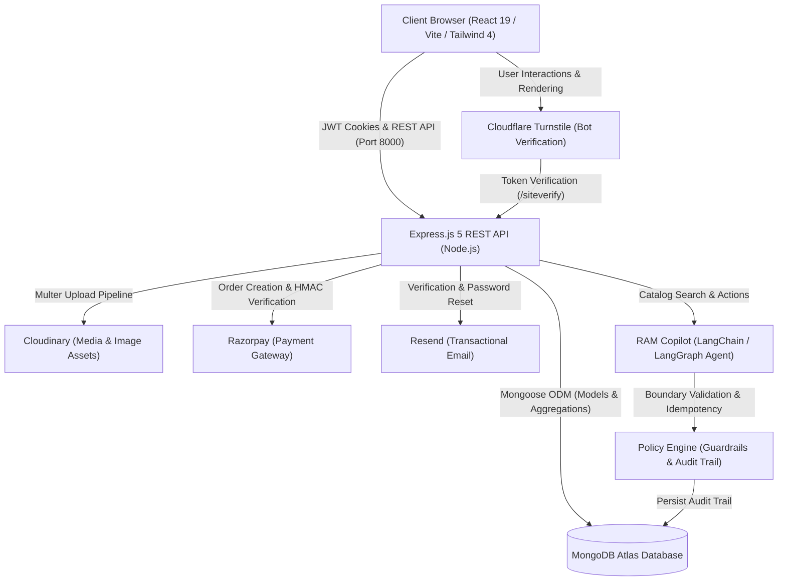

# 🛒 Full-Stack E-Commerce Monorepo

[](LICENSE)
[](https://react.dev/)
[](https://vitejs.dev/)
[](https://nodejs.org/)
[](https://expressjs.com/)
[](https://www.mongodb.com/)
[](https://tailwindcss.com/)
[](https://www.cloudflare.com/products/turnstile/)

A full-stack e-commerce monorepo featuring role-based access control (Customer and Seller), secure session authentication, Cloudflare Turnstile bot protection, Cloudinary media management, Razorpay payment processing, and an intelligent AI commerce assistant (**RAM Copilot**) with deterministic policy guardrails built on LangChain and LangGraph.

---

## 📌 Project Origins & Monorepo Consolidation

This repository is a **unified monorepo** consolidating two previously independent repositories into a single cohesive project structure to simplify full-stack development, dependency management, and architecture review:

* **Original Frontend Repository:** [basantbansal/Ecommerce_website_frontend](https://github.com/basantbansal/Ecommerce_website_frontend)
* **Original Backend Repository:** [basantbansal/Ecommerce_website_backend](https://github.com/basantbansal/Ecommerce_website_backend)

> [!NOTE]
> **Git History & Provenance Transparency:**
> This repository consolidates the source code of both original repositories and initiates a clean, unified monorepo Git history. The underlying features, API contracts, schema designs, and user interface components originated in the individual repositories above and have been integrated here for ongoing maintenance and unified presentation.

---

## 🏗️ System Architecture



---

## ✨ Verified Features

### 1. Authentication & Security
* **JWT Token Pair Pattern:** Short-lived access tokens and long-lived refresh tokens delivered via secure `httpOnly`, `sameSite` cookies.
* **Password Hashing:** Industry-standard salted hashing via `bcrypt`.
* **Bot Deterrence:** Cloudflare Turnstile CAPTCHA verification on login endpoints to defend against automated brute-force attacks.
* **Email Verification & Password Recovery:** Non-blocking transactional email flows powered by Resend with cryptographically generated tokens.
* **OAuth 2.0 Integration:** Google One-Tap and standard Sign-In via `@react-oauth/google` with server-side token validation (`google-auth-library`).

### 2. Storefront, Catalog & Cart
* **Dynamic Product Catalog:** Responsive product grid with category filtering, real-time search, price indicators, and stock availability badges.
* **Product Detail Views:** Dynamic product pages featuring image showcases, review ratings, detailed descriptions, and instant add-to-cart actions.
* **Persistent Cart Management:** Cart synchronization with React Context and backend MongoDB storage, supporting incremental adjustments and item removals.

### 3. Orders & Payment Processing
* **Idempotent Order Placement:** Unique idempotency key generation to prevent double-charging on network retries or duplicate button clicks.
* **Razorpay Gateway Integration:** Complete checkout lifecycle from server-side order generation to client-side modal checkout and backend `HMAC-SHA256` signature verification.
* **Order History Dashboard:** Authenticated customer purchase history tracking completed orders, timestamps, shipping summaries, and itemized receipts.

### 4. Seller & Inventory Management
* **Role Elevation:** Authenticated users can activate seller status with a single action.
* **Product Inventory Management:** Dedicated seller portal to publish new products, upload image assets via Multer to Cloudinary, update live stock quantities, and remove listings.

### 5. RAM Copilot (AI Commerce Assistant)
* **Agentic Shopping Engine:** Conversational AI built with LangChain and LangGraph to perform natural-language catalog discovery and cart suggestions.
* **Deterministic Policy Engine:** Enforces strict boundary rules on discounts (capping maximum discounts), blocks unauthorized price modifications, and rejects malformed payloads.
* **Adversarial & Honeypot Defenses:** Validated against prompt injection attacks and concurrent race conditions with unique idempotency keys and full audit trail logging in MongoDB.

---

## 🛠️ Technology Stack

| Domain | Technologies |
| --- | --- |
| **Frontend Framework** | [React 19](https://react.dev/), [Vite 6](https://vitejs.dev/) |
| **Styling & UI** | [Tailwind CSS 4](https://tailwindcss.com/), [React Icons](https://react-icons.github.io/react-icons/), [GSAP](https://greensock.com/gsap/) |
| **Client Routing & State** | [React Router DOM 7](https://reactrouter.com/), React Context API |
| **Backend Runtime & API** | [Node.js](https://nodejs.org/) (ES Modules), [Express 5](https://expressjs.com/) |
| **Database & ODM** | [MongoDB Atlas](https://www.mongodb.com/), [Mongoose 9](https://mongoosejs.com/) (`mongoose-aggregate-paginate-v2`) |
| **Security & Authentication** | JSON Web Tokens (`jsonwebtoken`), `bcrypt`, Cloudflare Turnstile, `@react-oauth/google` |
| **Payment Gateway** | [Razorpay](https://razorpay.com/) Node.js SDK & Checkout JS |
| **Media & File Storage** | [Cloudinary](https://cloudinary.com/) API via [Multer](https://github.com/expressjs/multer) |
| **Transactional Email** | [Resend](https://resend.com/) SDK |
| **AI Agent & Orchestration** | [LangChain Core](https://js.langchain.com/), [LangGraph](https://langchain-ai.github.io/langgraphjs/), Google GenAI / OpenAI APIs |
| **Code Quality & Tooling** | [ESLint 9](https://eslint.org/), [Prettier](https://prettier.io/), [Nodemon](https://nodemon.io/) |

---

## 📡 Backend API Endpoints

All API routes are served under `/api/v1` and protected by IP rate limiting (`express-rate-limit`):

### Health & Monitoring
* `GET /api/v1/health` — Service status and MongoDB connection check.

### Authentication & User Management (`/api/v1/users`)
* `POST /register` — Register new customer account (supports avatar & cover image uploads).
* `POST /login` — Authenticate user (validated via Cloudflare Turnstile token).
* `POST /google-login` — Authenticate or register with Google OAuth ID token.
* `POST /verify-email` — Verify email address via verification token.
* `POST /resend-verification` — Request a new email verification token.
* `POST /forgot-password` — Initiate password recovery link.
* `POST /reset-password` — Complete password reset with secure token.
* `POST /logout` — Clear session cookies (`verifyJWT`).
* `POST /refresh-token` — Issue fresh access token using refresh token cookie.
* `GET /current-user` — Retrieve authenticated user profile (`verifyJWT`).
* `POST /become-seller` — Upgrade account role to seller (`verifyJWT`).
* `POST /change-password` — Update current password (`verifyJWT`).
* `PATCH /update-account` — Update account profile details (`verifyJWT`).

### Catalog & Products (`/api/v1/products`)
* `GET /` — List products with pagination and category filters.
* `GET /agent-catalog` — Lightweight catalog view optimized for AI agent context.
* `POST /store-products` — Add a new product with image asset (`verifyJWT`, Seller).
* `POST /import-dummy-products` — Import dummy products for development (`verifyJWT`).
* `GET /:productId` — Retrieve full product details by ID.
* `DELETE /:productId` — Remove product listing (`verifyJWT`, Seller).
* `PATCH /:productId/stock` — Update inventory stock quantity (`verifyJWT`, Seller).

### Cart Management (`/api/v1/cart`)
* `GET /` — Retrieve active user cart (`verifyJWT`).
* `DELETE /` — Clear all items from cart (`verifyJWT`).
* `POST /items` — Add item to cart (`verifyJWT`).
* `PATCH /items/:productId` — Update item quantity (`verifyJWT`).
* `DELETE /items/:productId` — Remove specific item from cart (`verifyJWT`).

### Orders & Checkout (`/api/v1/orders`)
* `GET /` — Retrieve authenticated user order history (`verifyJWT`).
* `POST /` — Place new order with idempotency protection (`verifyJWT`).

### Payments (`/api/v1/payments`)
* `POST /:paymentId/confirm` — Confirm manual/cod payment status (`verifyJWT`).
* `POST /:paymentId/razorpay-order` — Create Razorpay order (`verifyJWT`).
* `POST /:paymentId/razorpay-verify` — Verify cryptographic signature of payment (`verifyJWT`).

### AI Agent & Audit (`/api/v1/agent`)
* `POST /chat` — Conversational shopping query through RAM Copilot (`verifyJWT`).
* `GET /audit/:sessionId` — Fetch audit trail and policy decisions for a session (`verifyJWT`).

---

## 📂 Repository Layout

```
Ecommerce_website_monorepo/
├── backend/
│   ├── public/temp/           # Temporary staging for Multer image uploads
│   ├── src/
│   │   ├── controllers/       # Business logic (user, product, cart, order, payment, agent)
│   │   ├── db/                # MongoDB connection handler
│   │   ├── middlewares/       # Authentication (verifyJWT) and file upload (Multer)
│   │   ├── models/            # Mongoose schemas (User, Product, Cart, Order, Payment, AgentAudit)
│   │   ├── routes/            # Express route declarations
│   │   ├── scripts/           # Catalog seed scripts & adversarial test suites
│   │   ├── services/          # RAM Copilot agent core, tool registry & policy engine
│   │   ├── utils/             # ApiError, ApiResponse, asyncHandler, Cloudinary & Resend helpers
│   │   ├── app.js             # Express application & middleware configuration
│   │   ├── index.js           # Server entry point
│   │   └── setup.js           # Environment loader (.env)
│   ├── .env.sample            # Backend environment template
│   ├── nodemon.json           # Nodemon watcher configuration (src/ and .env)
│   └── package.json           # Backend dependencies and scripts
├── frontend/
│   ├── public/                # Static assets & public favicon
│   ├── src/
│   │   ├── assets/            # Vector logos and icons
│   │   ├── components/        # UI components & RAM Copilot chat widget
│   │   ├── context/           # React Context providers (User, Cart, Purchased)
│   │   ├── pages/             # Route pages (Home, ItemDetails, Cart, Auth, Seller, Admin)
│   │   ├── api.js             # Axios instance with base URL configuration
│   │   ├── App.js             # Main router and layout
│   │   └── index.js           # React root & OAuth provider mount
│   ├── .env.sample            # Frontend environment template
│   ├── eslint.config.js       # ESLint 9 configuration
│   ├── vite.config.js         # Vite configuration (port 3000, React plugin, Tailwind)
│   └── package.json           # Frontend dependencies and scripts
├── .env.example               # Root reference environment template
├── .gitignore                 # Root gitignore protecting secrets, builds, and media
├── CONTRIBUTING.md            # Contribution guidelines
├── LICENSE                    # MIT License
└── README.md                  # Project documentation
```

---

## 🚀 Local Development Setup

### Prerequisites
* **Node.js**: v18.0.0 or higher (v20+ recommended)
* **npm**: v9.0.0 or higher
* **MongoDB**: A running local MongoDB instance (`mongodb://localhost:27017`) or a free [MongoDB Atlas](https://www.mongodb.com/atlas) connection string

---

### Step 1: Clone the Repository

```bash
git clone https://github.com/basantbansal/Ecommerce_website_monorepo.git
cd Ecommerce_website_monorepo
```

---

### Step 2: Install Dependencies

Install dependencies for both frontend and backend workspaces:

```bash
# Install backend dependencies
npm --prefix backend install

# Install frontend dependencies
npm --prefix frontend install
```

---

### Step 3: Configure Environment Variables

The repository includes pre-configured sample files. For local testing, **no paid third-party accounts are required** for basic browsing, cart operations, and authentication.

#### 1. Backend Configuration
Copy `backend/.env.sample` (or `backend/.env.example`) to `backend/.env`:

```bash
cp backend/.env.sample backend/.env
```

Set the required local values in `backend/.env`:
* `MONGODB_URI`: `mongodb://localhost:27017` (or your Atlas connection string).
* `PORT`: `8000`
* `ACCESS_TOKEN_SECRET` / `REFRESH_TOKEN_SECRET`: Any two arbitrary secret strings (minimum 32 characters recommended).
* `TURNSTILE_SECRET_KEY`: Use Cloudflare's public testing secret key (always passes verification):
  ```env
  TURNSTILE_SECRET_KEY=1x0000000000000000000000000000000AA
  ```

*(Optional integrations: Cloudinary, Razorpay, Resend, and AI API keys can be supplied when exercising those respective features).*

#### 2. Frontend Configuration
Copy `frontend/.env.sample` (or `frontend/.env.example`) to `frontend/.env.local`:

```bash
cp frontend/.env.sample frontend/.env.local
```

The sample defaults work out of the box for local development:
```env
VITE_API_URL=http://localhost:8000
VITE_TURNSTILE_SITE_KEY=1x00000000000000000000AA
```

---

### Step 4: Seed the Database (Optional)

Populate your database with sample catalog items:

```bash
# Seed initial product catalog:
node backend/src/scripts/seedProducts.cjs

# Or seed an expanded catalog:
node backend/src/scripts/seedExpandedProducts.cjs
```

---

### Step 5: Start the Development Servers

Run the backend and frontend development servers concurrently:

```bash
# Terminal 1: Start Backend (Express API on http://localhost:8000)
npm --prefix backend run dev

# Terminal 2: Start Frontend (Vite Client on http://localhost:3000)
npm --prefix frontend start
```

Open **`http://localhost:3000`** in your browser to interact with the application.

---

## 💻 Available Scripts & Commands

| Scope | Command | Purpose |
| --- | --- | --- |
| **Backend** | `npm --prefix backend run dev` | Runs backend API with Nodemon live reload (watches `src/` and `.env`) |
| **Backend** | `npm --prefix backend start` | Starts backend API with standard Node process |
| **Backend** | `node backend/src/scripts/runTests.js` | Runs the AI Copilot integration test suite |
| **Backend** | `node backend/src/scripts/test_adversarial.js` | Runs the adversarial & policy engine security suite |
| **Frontend** | `npm --prefix frontend start` | Starts the Vite development server (`http://localhost:3000`) |
| **Frontend** | `npm --prefix frontend run build` | Builds optimized production bundle into `frontend/dist` |
| **Frontend** | `npm --prefix frontend run lint` | Runs ESLint 9 checks across all frontend source files |
| **Frontend** | `npm --prefix frontend run preview` | Serves the production build locally for smoke testing |

---

## 🛡️ Testing & Security Guardrails

The backend includes dedicated test suites verifying the AI agent's deterministic policy engine and security boundary conditions:

```bash
# Run adversarial and idempotency tests:
node backend/src/scripts/test_adversarial.js

# Run copilot scenario integration tests:
node backend/src/scripts/runTests.js
```

### Verified Test Scenarios:
1. **Normal Purchase Evaluation:** Verifies standard proposals pass policy validation.
2. **Transaction Cap Enforcement:** Blocks order proposals exceeding ₹50,000 threshold.
3. **Hallucination Protection:** Identifies and blocks fabricated or non-existent product IDs.
4. **Negative Quantity Defense:** Defends against mathematical manipulation attempts.
5. **Concurrent Race Attack Defense:** Simulates concurrent duplicate requests and validates that MongoDB idempotency keys ensure exactly one execution.

---

## 📸 Recommended Portfolio Screenshots

Adding screenshots to this repository will give recruiters an immediate visual overview of your work:

1. **Storefront & Product Catalog:** Showcases the responsive product grid, search filtering, price formatting, and responsive Tailwind layout.
2. **Product Details & Cart Drawer:** Highlights state management, stock availability badges, and dynamic subtotal calculations.
3. **Cloudflare Turnstile Protected Login:** Demonstrates bot protection UX and clean form validation.
4. **Seller Management Portal:** Showcases inventory creation, image asset uploads to Cloudinary, and stock adjustments.
5. **RAM Copilot Shopping Assistant:** Demonstrates conversational product discovery, discount negotiation boundaries, and real-time cart interaction.

---

## 🏷️ Recommended GitHub Topics

When configuring your GitHub repository settings, the following topics enhance visibility and recruiter discovery:

`ecommerce` • `fullstack` • `react` • `react19` • `vite` • `nodejs` • `express` • `mongodb` • `tailwindcss` • `langchain` • `langgraph` • `ai-agent` • `razorpay` • `cloudflare-turnstile` • `monorepo` • `jwt-authentication`

---

## 🤝 Contributing

Contributions are welcome! Please follow these steps:
1. Fork the repository.
2. Create a feature branch (`git checkout -b feature/amazing-feature`).
3. Commit your changes (`git commit -m 'feat: add amazing feature'`).
4. Push to the branch (`git push origin feature/amazing-feature`).
5. Open a Pull Request.

Refer to [`CONTRIBUTING.md`](CONTRIBUTING.md) for detailed guidelines and coding standards.

---

## 📜 License

This project is licensed under the [MIT License](LICENSE) © 2026 Basant Bansal.
